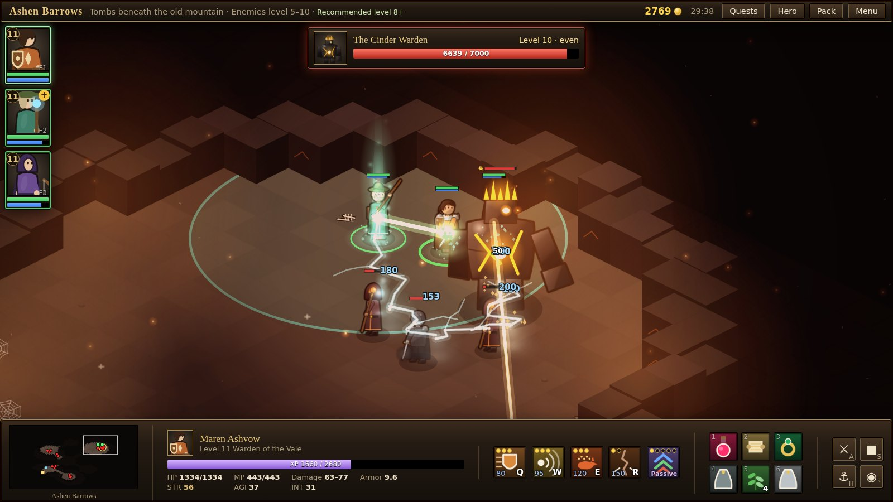
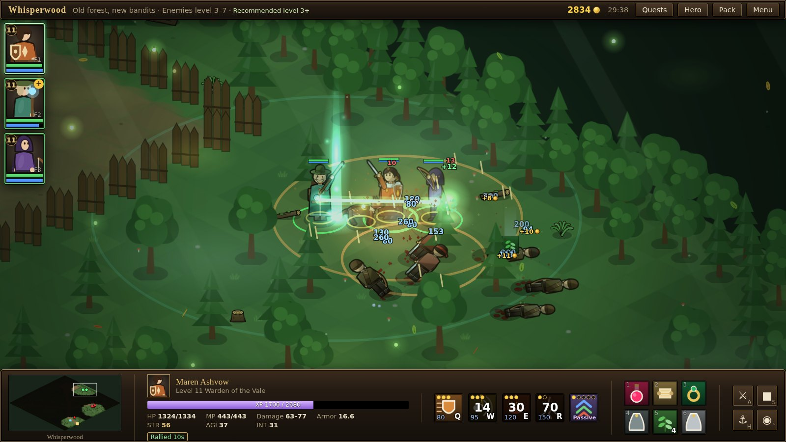
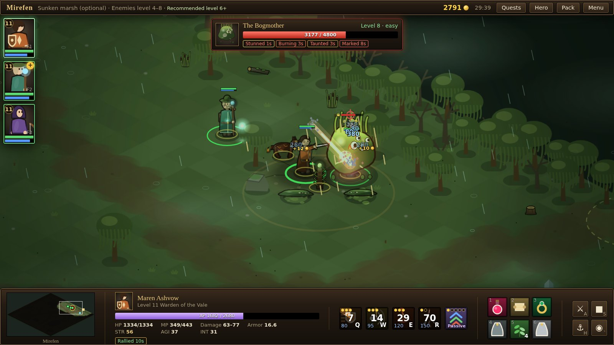
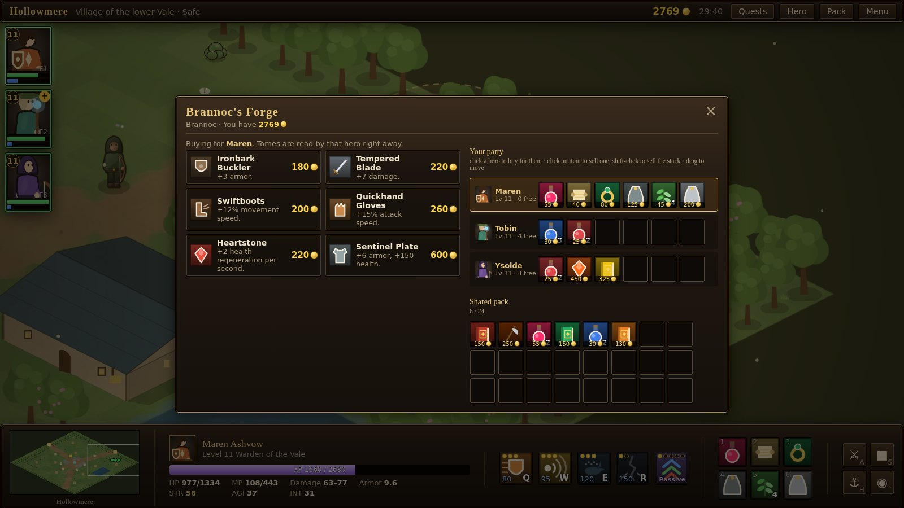

# Embervale: The Ember Road

**A Warcraft III–style hero-party Action RPG that runs in your browser.** Lead three heroes through an isometric valley, fight packs of bandits and beasts with spells and gear, and take down bosses with telegraphed attacks. No install, no account, no downloads.

### ▶ [Play it in your browser](https://dafioram.github.io/embervale/)

*Version 1.0 · Desktop browser with mouse and keyboard (a controller works too) · About 2 hours of play*



## Why play it

- **A small party you control directly.** Maren the warden holds the line, Tobin the hedge-shaman heals and throws lightning, and Ysolde the ember hunter shoots from the back. Select them together or one at a time, focus targets, kite, and spend skill points as they level.
- **Bosses that make you move.** Greymane, Grell Thornjaw, the Bogmother and the Cinder Warden each have their own attacks, shown on the ground before they land.
- **A world that feels alive.** Every zone has its own weather, light, music and ambient sound, from fireflies in Whisperwood to rain over Mirefen and embers in the Barrows.
- **Gear you can see.** Swords, shields, helms and cloaks show up on the heroes as you equip them.
- **Everything is made with code.** All the art is drawn and all the music synthesized at runtime: no image or audio files, no frameworks, no build step.

| Bandits in Whisperwood | The Bogmother in Mirefen |
|---|---|
|  |  |



## How long is it?

- **Act I, The Ember Road:** about an hour. Five main quests, six side quests, four bosses and a three-wave defense of the mill.
- **The Underhollow:** about another hour. A ten-floor post-game dungeon that unlocks when you finish Act I, with two more bosses and better loot.
- **Act II** may come later. The Act I ending leaves a hook, and your save can carry forward.

## Your saves

Progress saves in your browser (`localStorage`): the game autosaves when you change zones, finish quests and every minute, and there are three manual slots. Nothing is uploaded anywhere.

Because saves live in one browser, clearing your browsing data deletes them. To keep a copy or move to another computer, use **Menu → Export save to JSON file**, and **Import save** (in the menu or on the title screen) to load it back. Keep that file if you want to carry your party into a later act.

## Found a bug?

If something breaks, the game shows an error box with a **Copy details** button. Please paste those details into a [GitHub issue](https://github.com/dafioram/embervale/issues) with a line about what you were doing. Issues about balance, confusing quests or things that felt bad are welcome too.

## Running it yourself

**Locally:** download or clone this repository and open `index.html` in a browser. That works straight from the file system. If your browser is strict about local files, serve the folder instead:

```bash
python3 -m http.server 8000
# then open http://localhost:8000
```

**On GitHub Pages:**

1. Push this folder to a GitHub repository (the `index.html` file should be at the repository root).
2. In the repository, go to **Settings → Pages**.
3. Under **Build and deployment**, choose **Deploy from a branch**, pick `main` and `/ (root)`, then save.
4. After a minute the game is live at `https://dafioram.github.io/embervale/`.

The `screenshots/` folder is only for this README; the game doesn't load it.

The empty `.nojekyll` file tells Pages to serve the files as they are.

## What's in the game

| | |
|---|---|
| **Heroes** | Maren Ashvow (warden, melee tank), Tobin Reedwhistle (hedge-shaman, healer and lightning), Ysolde Vane (ember hunter, ranged). You start with Maren and recruit the others during the story. Each hero has three basic abilities, an ultimate, and Attribute Training, a passive that adds +2 to all attributes per rank so no skill point goes to waste. |
| **Zones** | Hollowmere (village hub), Brindle Fields, Whisperwood, Mirefen (optional) and the Ashen Barrows. |
| **Quests** | 5 main story quests and 6 side quests. |
| **Bosses** | Greymane the Old Alpha, Grell Thornjaw, the Bogmother (optional) and the Cinder Warden. |
| **Set piece** | A three-wave defense of the mill in Brindle Fields. |
| **Economy** | Three shops in town plus a peddler you can rescue. Tomes raise attributes permanently and cost a little more each time you buy one. Gold is shown with a small coin icon. |
| **Atmosphere** | Each zone has its own weather and light: pollen, butterflies and cloud shadows in the fields; fireflies, falling leaves, light shafts and mist in Whisperwood; rain, mist and midges in Mirefen; braziers, embers and ash in the Barrows; blue crystal lights in the Underhollow. Trees sway in the wind. |
| **Art** | Flat vector characters with two-tone shading, rim light and thick outlines. Heroes show the weapons, shields, helms and cloaks they have equipped. Enemies come in a few looks per type so packs don't look cloned, and every boss has its own design. Units have idle, walk, attack, cast, hurt and death animations, and burn, poison, chill, webs, mire and Shaken show on the unit. Each kind of enemy dies its own way (cinders, ghosts, splats, rubble), fights leave fading blood, scorch marks and craters on the ground, and each zone is dressed with small props such as bushes, stumps, reeds, barrels, gravestones, bones and crystals. |
| **Music and sound** | A theme for each zone (Hollowmere, Brindle Fields, Whisperwood, Mirefen, the Ashen Barrows and the Underhollow). Drums and bass fade in when a fight starts, bosses get the Barrows battle theme, and music dips while a dialogue or menu is open. Each zone also has background sound (birds, crickets and an owl, frogs, cave drips, crackling embers). |

### Post-game: the Underhollow

After you finish Act I, Elder Odrin offers **Trouble Below**. A sinkhole opens in the road by the forge in Hollowmere, leading down into the Underhollow, a ten-floor dungeon (about an hour).

- **Floors** are generated cave levels with 3–6 enemy camps each. A guardian camp seals the stairs down; defeat it to open the way. Opened stairs stay open.
- **Difficulty** rises one enemy level per floor (level 10 on floor 1 to level 19 on floor 10), with health and damage up about 9% per level. Past floor 6 the enemies out-level a capped party, so tomes and gear matter.
- **Bosses:** the Brood Mother on floor 5 and the Hollow King on floor 10.
- **Checkpoints:** waystones on floors 3, 5, 7 and 10, each right where you arrive (floors 5 and 10 are the boss floors). A party wipe still sends you to town; use a waystone to return to your deepest checkpoint.
- **Rewards:** experience and gold scale with depth, a deep loot table with new gear, and a unique drop from each boss.
- **Switching it off:** set `G.FEATURES.underhollow = false` at the top of `js/data/underhollow.js`. The quest, the sinkhole and the dungeon waystones disappear; saves stay compatible.

### How the rules work

- **XP is shared.** Every hero in the party earns full XP from each kill. Recruits join at the party's current level with skill points to spend.
- **Party wipes are forgiving.** If everyone falls, you wake up in Hollowmere and keep all experience, gold and items. A single fallen hero gets back up once the party has been out of combat for a few seconds. Tobin's Spirit Tide and a **Phoenix Feather** (sold by Marta, sometimes dropped by bosses) revive a fallen hero mid-fight. Any hero who gets back up is **Shaken** for 30 seconds (20% less damage); resting at a waystone or the inn clears it.
- **Enemies respawn.** A cleared camp comes back when you re-enter its zone after about 90 seconds of play. Experience drops off against enemies far below your level, so revisiting old areas helps a little but not forever. Bosses and other unique enemies stay dead.
- **Recovery between fights.** Heroes recover faster after about 6 seconds out of combat.
- **Minimap.** Ground you haven't explored stays dark on the minimap, and so do the enemies, people and exits in it. Quest markers, bosses and your heroes always show. Each zone remembers what you've explored.
- **Waystones.** Walking near a waystone attunes it. Using any waystone restores the party and lets you travel to any other waystone you have attuned. The travel list is always in the same order (Hollowmere first, then each zone, then the Underhollow floors), with the waystone you're standing at greyed out.

## Controls

### Mouse and keyboard

| Input | Action |
|---|---|
| Right-click | Move. On an enemy: attack. On a person, object or item: talk, use or pick up. |
| Left-click / drag | Select heroes. Shift-click adds a hero to the selection. |
| Left-click an enemy | Show it in the target frame at the top of the screen (name, level, health, effects). It stays until the enemy dies, you click another unit, or press Esc. Bosses appear there automatically during a fight. |
| Q W E R | Cast abilities. Targeted abilities show a preview; left-click to confirm and right-click to cancel. |
| T | Attribute Training (passive). |
| Shift + Q/W/E/R/T | Learn or rank up an ability (or click the **+** on its button). A gold **+** on a portrait means a point you can spend now; a dim number means a point saved for a later level. |
| 1–6 | Use the item in that slot. |
| A | Attack-move: move and fight anything in the way. |
| S / H | Stop / hold position. |
| F1–F3 | Select a hero. Tap twice to jump the camera to them. |
| Tab | Cycle the active hero. |
| Ctrl+A or \` | Select the whole party. |
| Space | Recenter the camera and follow the active hero. |
| Arrow keys, middle-drag, minimap | Pan the camera. Right-click the minimap to move there. |
| Mouse wheel | Zoom. |
| I / C / L | Inventory / hero sheet / quest log. |
| P | Pause. |
| Esc | Cancel targeting, close a panel, clear the target frame, or open the menu. |

In the inventory you can drag items between heroes and the shared pack. Left-click an item to use it; right-click to move it to the pack. In a shop, every hero's bag and the pack are shown: click a hero to buy for them, click an item to sell one (shift-click sells the whole stack), drag to move items, and hover gear to see what it would change for that hero.

### Controller (standard mapping)

| Input | Action |
|---|---|
| Left stick | Move the selected heroes. |
| Right stick | Pan the camera. |
| A | Attack the nearest enemy, or talk to or use whatever is closest. |
| X / Y / B / RB | Cast Q / W / E / R. Targets are chosen automatically. |
| LB + ability button | Learn that ability (Attribute Training is learned from the hero sheet). |
| LB | Cycle the active hero. |
| LT / RT | Use item slots 1 and 2. |
| D-pad up / down | Select all / select only the active hero. |
| Start / Back | Menu / quest log. |

Shops and the inventory are easiest with a mouse.

## Saving in detail

- The game autosaves when you change zones, finish quests and every minute (except during the mill defense). It also has three manual slots. All of these are stored in the browser's `localStorage`.
- **Menu → Export save** downloads the current game as a `.json` file. **Import save** (in the menu or on the title screen) loads one back. Use this to back up progress, move it to another browser or computer, or keep it for later acts.
- Settings (volume, music, ambience, effects, zone atmosphere, edge panning, quick-cast and so on) are saved separately. Turning off **Zone atmosphere** removes the particles, weather, tree sway and wall torches, which helps on slow computers. **Show FPS** puts a frame-rate readout in the corner.

The save format is versioned (`"version": 1`). Missing fields are filled with defaults when an older save loads, so future acts can keep reading Act I saves.

## Project layout

```
index.html            page shell and HUD markup
css/style.css         all UI styling
js/core/crash.js      version number, error box, phone notice
js/core/util.js       math helpers, seeded RNG, noise, A* pathfinding
js/data/              game content (pure data plus a few small hooks)
  heroes.js           hero stats, growth, XP curve, stat formulas
  abilities.js        hero abilities: costs, cooldowns, text and cast logic
  items.js            items, tomes, shops, loot tables
  units.js            enemies, summons, structures, boss special moves
  zones.js            zone layouts: features, exits, NPCs, objects, camps
  quests.js           NPCs, dialogue, quests and the quest engine
  underhollow.js      the post-game dungeon: floor generator, enemies, bosses, loot, quest
js/core/worldgen.js   turns a zone definition into tiles, blockers and props
js/core/world.js      the live zone: entities, spawning, objects, loot, exits
js/core/ai.js         orders, movement, attacking, casting and creep AI
js/core/combat.js     damage, healing, buffs and death
js/core/fx.js         particles, projectiles, telegraphs and floating text
js/core/input.js      mouse and keyboard
js/core/gamepad.js    controller support (Gamepad API)
js/core/save.js       localStorage slots, JSON export and import, settings
js/core/audio.js      audio engine: volume buses, reverb, synth instruments, sound effects
js/core/music.js      zone music (with combat layers) and background ambience
js/render/sprites.js  procedural art for trees, buildings and icons
js/render/units.js    unit art: heroes, gear, enemies, bosses, animation frames, status effects, deaths
js/render/deco.js     small decorative props for each zone
js/render/render.js   isometric renderer, lighting and minimap (with fog of war)
js/render/atmos.js    zone atmosphere: particles, weather, wind sway, torches, colour grade
js/ui/ui.js           HUD, dialogs, shops, inventory, quest log and menus
js/game.js            state, main loop, party management, the mill event
tools/check-zones.js  layout checker (see below)
screenshots/          images for this README
```

The scripts are plain `<script>` tags that share one global namespace, `G`. There are no modules, so the game also runs from `file://`.

## Adding content

Most content is data, so adding to the game rarely needs engine changes.

- **A new zone:** add an entry to `G.ZONES` in `zones.js`. Give it a size, seed, theme (`village`, `meadow`, `forest`, `swamp` or `cave`), a feature list (paths, water, clearings, buildings, fences, stockades, rooms, tunnels, gates), exits, entries, NPCs, objects and camps. Then link it from another zone's `exits`. Run the layout checker afterwards.
- **A new enemy:** add it to `G.UNITS` in `units.js`. Pick a `shape` the art code knows (`humanoid`, `boar`, `wolf`, `spider`, `blob`, `stalker`, `wisp`, `imp`, `golem` or `ward`) and colors. Humanoids can get a custom look (hood, helm, weapon and so on) in the `ENEMY` table in `js/render/units.js`. For boss mechanics, add a function to `G.ENEMY_SKILLS` and reference it from the unit's `skills` list, either on a cooldown (`cd`) or at a health threshold (`at`).
- **A new quest:** add it to `G.QUESTS` in `quests.js`. Objectives can be `kill`, `collect`, `interact` or `flag`. Use `onAccept` and `onComplete` hooks for story beats, and `markers` to point the minimap at the objective.
- **Items and shops:** see `G.ITEMS` and `G.SHOPS` in `items.js`.

### Using your own music

Every theme is synthesized, but you can replace any of them with a recorded track. Put the files in a `music/` folder and list them at the top of `js/core/music.js`:

```js
G.MUSIC_FILES = {
  hollowmere: 'music/hollowmere.mp3',
  barrows: 'music/barrows.mp3',
  barrows_combat: 'music/barrows-combat.mp3', // optional: crossfades in during fights
};
```

The theme ids are `hollowmere`, `brindle`, `whisperwood`, `mirefen`, `barrows` (also used for boss fights) and `underhollow`. A `<id>_combat` file is optional; without it, the track keeps playing through fights. Themes you don't list stay synthesized. Check the licence of any music you add, and credit it in this README if the licence asks for that.

### Layout checker

```bash
node tools/check-zones.js
```

This generates every zone and confirms that every camp, NPC, object, entry and exit can be reached on foot. Run it after editing `zones.js`.

## Known limitations

- Fog of war covers only the minimap, and pathfinding is simpler than in a commercial RTS engine. Units can sometimes bunch up in narrow passages.
- Music and sound are synthesized, so they have a light, retro-instrument character. Recorded tracks can replace any theme (see *Using your own music*).
- The camera, HUD and controls are built for desktop screens. Phones and tablets get a "please play on a computer" screen (with a **Try anyway** button).
- Tested in Chrome and Firefox. Safari should work but hasn't been tested much.
- Act II isn't written yet. The Act I ending leaves a hook (the Kindler escapes up the mountain), and saves are ready to carry forward.

## Credits

Game design, story, code and art were created for this project. The UI fonts, Cinzel and Alegreya Sans, load from Google Fonts under the SIL Open Font License. If they can't load, the game falls back to system fonts.

## License

Released under the [MIT License](LICENSE). You're welcome to fork it, mod it, or learn from it.
